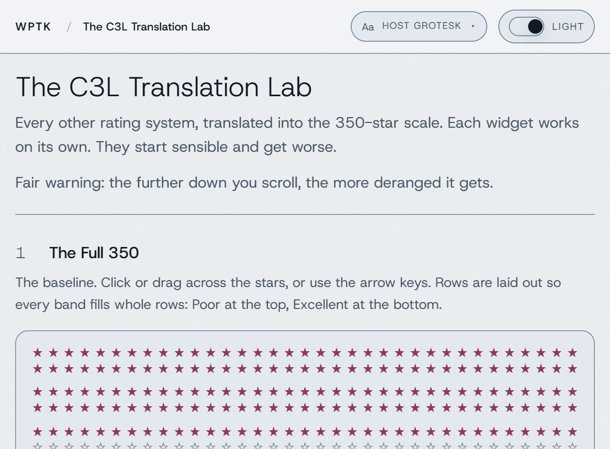
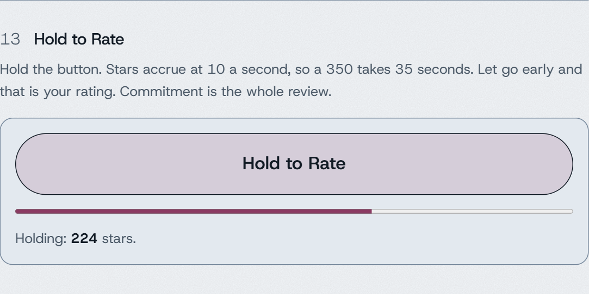
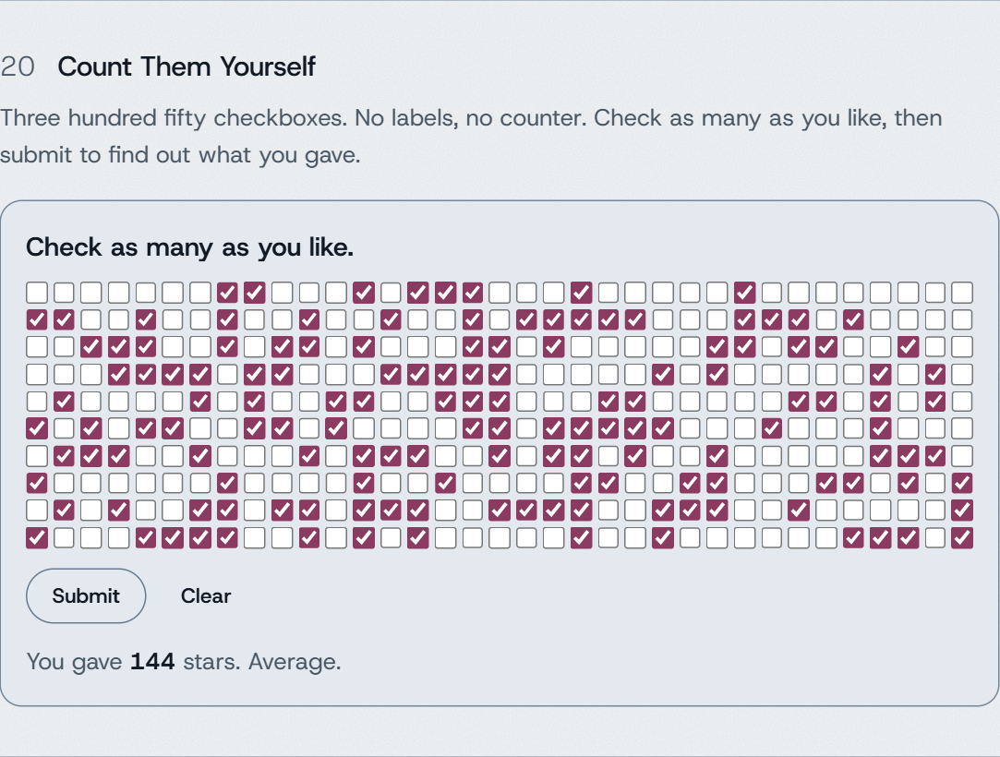
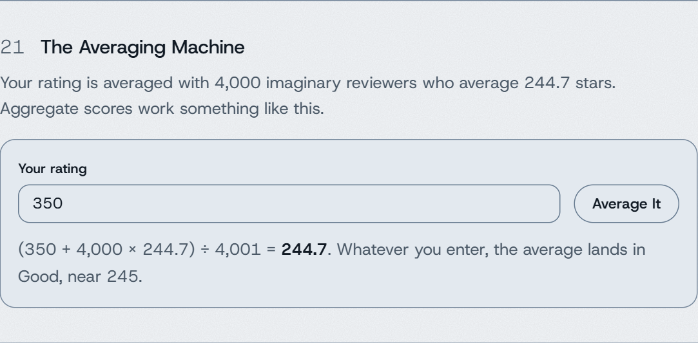
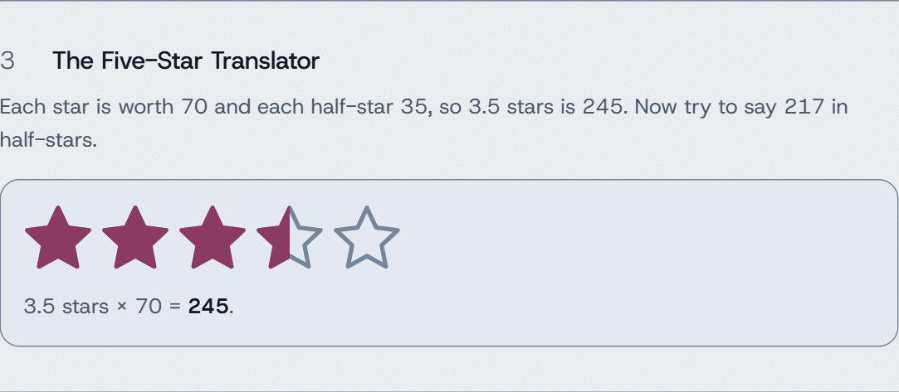

My proposal for a [350-star rating system](https://wptk.org/350.html) has a section called "Usability and Practical Implementation." It's two sentences long, and it says the system would need "sliders, incremental selectors, or numeric inputs." That's three kinds of input. I built 21 widgets.

If you haven't read the proposal, the argument is that scales with 3, 5, 10 or 100 points are too coarse, and 350 stars (C3L for short, because 350 is CCCL in Roman numerals) gives you room for real nuance. It's a system meant to provide clarity. The widgets live in the [C3L Translation Lab](https://wptk.org/c3l), where each one takes some other rating system and translates it into 350 stars. Each widget works on its own. They start sensible and get progressively more deranged.

## What the research says (it says don't)

I designed surveys and ratings back when I was an instructional designer. This is obviously a little different, so I did some research first, and it came back with this:[^1]

- People handle roughly 5 to 11 points comfortably.
- Going from 3 points to somewhere in that range gets you better data.
- Sliders can lower completion rates. They're also slower, harder for some people to use, and the data they produce is harder to quantify.
- Standard scales win, because your numbers can be compared with everybody else's.
- One study put 348 people in front of four different scales, and the biggest was a 100-point slider.[^2] I assume 350 was out of budget.

A 350-point scale ignores all of that on purpose, since short, comfortable scales are what the proposal argues against. What the research did change is the design. It's why the Lab is a *translation* lab, where every widget starts from a scale people already know and ends at 350.

It helps that 350 divides evenly by 5, 7, 10 and 14, so the translators land on whole numbers.

## The deranged half has a precedent

The bottom of the page borrows its spirit from the "worst volume control" challenge that programmers on Reddit ran in 2017.[^3] People built volume controls out of a curling game and microtransactions. Two of the entries used password rules and dice, and so do two of my widgets.

## A few I'm fond of

### Hold to Rate (prove your love)

The proposal says a bigger scale makes you think harder about your rating, and this is the widget that makes you prove it. Stars accrue at 10 per second while you hold a button, and letting go is your rating. A perfect 350 takes 35 seconds, which is a long time to stand there wondering if the book was really *that* good.

### Count ’em yourself

This one is 350 unlabeled checkboxes and no counter. They're real checkboxes, all 350 of them, and you find out what you gave when you submit.

### The Averaging Machine

Your rating gets averaged with 4,000 imaginary reviewers who average 244.7 stars, so whatever you enter lands near 245. It's the last widget on the page, and it's what happens to all that clarity once 4,000 other people have had a turn.

## My first design was worse

The Lab is static HTML, CSS and vanilla JavaScript on Neocities. The whole thing went from ideas to mockups to a finished page in a day.

My first design had one shared rating that every widget followed, plus section headings. I threw that out for independent widgets, so you get to work out for yourself where the sensible part ends. I also caught a half-star that was drawn wrong, which is a bad look on a page about stars, so it's now a real SVG star cut at its center.

Even the deranged widgets are built from real radio buttons, range inputs and checkboxes. The sliders work from the keyboard, and so does the Pacing Swipe, which is otherwise a widget about dragging. If you have reduced motion turned on, a slider that normally creeps along on its own jumps straight to its target.

The Lab is at [wptk.org/c3l](https://wptk.org/c3l). Its tagline on the home page is "Not tested on humans." Go ruin that for me.

References:

[^1]: MeasuringU, ["Rating Scale Best Practices"](https://measuringu.com/rating-scale-best-practices-8-topics-examined/), UX Planet, ["Rating Scales: The More Points the Merrier"](https://uxplanet.org/rating-scales-the-more-points-the-merrier-975fa63fe5c7), and Zurb, ["Pick the Rating Scale the Evidence Supports"](https://radar.zurb.com/article/pick-the-rating-scale-the-evidence-supports). Going by the titles alone, I'm one for three.

[^2]: ["Rating: How Difficult Is It?"](https://rangevoting.org/sen-recsys2011.pdf), RecSys 2011. The four were unary, thumbs, five-star and a 100-point slider. 348 participants is two short of a perfect score.

[^3]: UX Collective, ["The Worst Volume Control UI in the World"](https://uxdesign.cc/the-worst-volume-control-ui-in-the-world-60713dc86950), and The New Stack, ["Bad by Design"](https://thenewstack.io/bad-by-design-the-world-of-intentionally-awful-user-interfaces/). It ran on r/ProgrammerHumor. Other entries included Morse code and a maximum limited by your battery, in case I ever need a 22nd widget.
